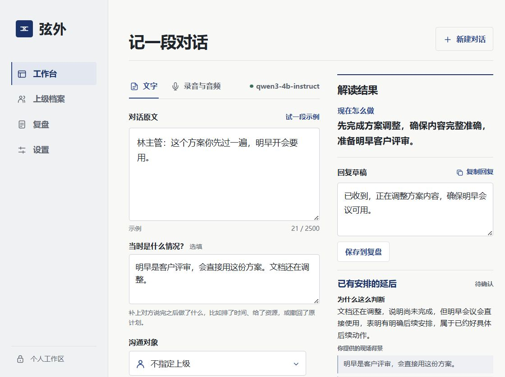

# Xianwai · Workplace Dialogue Interpretation (弦外)

[](https://github.com/sdss-arch/xianwai/actions/workflows/ci.yml)
[](https://github.com/sdss-arch/xianwai/releases)
[](LICENSE)

Paste a conversation, or record/import audio and proofread it, then add context and pick a manager. Xianwai extracts explicit asks, possible subtext, the original lines behind each reading, and a reply you can copy. You can keep separate profiles for several managers — communication habits, priorities, and concrete examples — and the model can distill habits from your confirmed cases for you to review.

> Also available in [中文](README.zh-CN.md).

**📥 Download:** [Windows installer-free package](https://github.com/sdss-arch/xianwai/releases/latest) · [Android APK](https://github.com/sdss-arch/xianwai/releases/latest) · or run from source (below).

## Screenshots

| Workbench with a loaded example | A real model reading (local Qwen3-4B) |
| --- | --- |
|  |  |

## How it works

```
Dialogue input (paste / record → on-device offline transcription → proofread & select)
   + context + manager profile (habits, priorities, examples)
        ↓  model reading (local llama.cpp running Qwen, or any OpenAI-compatible API)
Explicit asks / possible subtext / original-line evidence (quoted from your input) / a copyable reply
        ↓  save a review → fill in what actually happened → mark "confirmed" or "off target"
Model drafts a communication habit → you approve it into the manager profile
        ↓  future readings reuse at most three relevant approved cases for that manager,
           historical quotes and this round's evidence shown separately
```

- **Nothing is uploaded during import or recording**: only the sentences you tick, your context, and the selected profile are sent when you press "Start reading".
- Direct recordings stay under "Reviews → Local recordings" and can be reopened, exported, or deleted. Raw audio and keys are never included in a profile export.

## Quick start (Windows, browser)

> **Option A — prebuilt package:** download `xianwai-windows-0.6.1.zip` from the [latest release](https://github.com/sdss-arch/xianwai/releases/latest), unpack it, and jump to step 2. No git or build tools needed.
>
> **Option B — from source:**

1. Install [Node.js 22 or newer](https://nodejs.org/) and unpack or clone this repository.
2. Double-click `Start.cmd`. The first run downloads about 2.5 GB of local model and inference engine, then opens your browser.
3. Click "Load example" to fill in a dialogue, then "Start reading". Keep the computer and the launcher window running.

If an older version already occupies the default port 8787, the launcher tries 8793 and 8794. Each address keeps its own browser storage; use "Migrate profiles" to copy profiles between them.

## Phone recording and transcription (HTTPS entry)

1. Put the phone and computer on the same trusted Wi-Fi. In a command prompt on the computer, enter the project directory and run `Start.cmd -Phone -Address <LAN IPv4 of the computer>`. Generating the test certificate needs the OpenSSL that ships with Git for Windows, or set `OPENSSL` to an installed OpenSSL.
2. Send the `root.cer` shown in the window to the phone; its name should be `Xianwai Local Phone Preview` plus the computer's IP. On iPhone, install it, then enable full trust under **Settings → General → About → Certificate Trust Settings**. Android uses the system CA certificate installer. The test certificate is valid for 30 days and can be removed afterwards. If you already have a trusted HTTPS deployment, use that address instead. [Apple's certificate trust guide](https://support.apple.com/en-us/102390)
3. Open the HTTPS address shown in the launcher window and choose "Recording & audio". The first "Transcribe" loads about 100 MB of model and runtime files. Recording and import are limited to 2 minutes and 40 MB per clip. Listen back, edit, tick the lines, then start a reading.

A plain HTTP LAN entry works for import and text analysis; microphone access and custom API configuration require HTTPS or the computer-local entry. Profiles on the HTTP and HTTPS entries are stored separately — export them under "Profiles → Migrate profiles" and import on the other entry.

## Android app

> **Download:** grab `xianwai-android-0.6.1.apk` from the [latest release](https://github.com/sdss-arch/xianwai/releases/latest), or build it yourself (see "Rebuilding the Android APK" below).

1. Open the signed APK on an Android phone and install following the system prompts. The first install from a browser or file manager may require allowing that source.
2. Open "Settings" and enter your HTTPS API address, model name, and the key your provider requires. Any OpenAI-compatible Chat Completions endpoint works. Use "Test connection" first, then "Save". The key is stored encrypted with the Android Keystore.
3. On "Reading", record or import a file. The package includes the transcription model, so recording, transcription, and proofreading work offline. When you press "Start reading", the phone sends only the ticked text, context, and selected profile to your configured service over its own network connection. In-app recordings stay under "Reviews → Local recordings" and can be reopened, exported, or deleted.
4. Pick a workplace scenario and reply tone, and save results to "Reviews". Later, mark them "confirmed" or "off target", write what actually happened, and add them to that manager's profile by hand.

Android 8 is the minimum; transcription needs a fairly recent Android System WebView. Profiles created in the browser can be exported under "Profiles → Migrate profiles" and imported into the app. Recordings and proofreading are limited to 2 minutes per clip; raw audio and keys are never included in profile exports.

Android 0.6.1 shares the contextual reading and action rules with the browser version. Edit role, project responsibilities, authority, and communication preferences under "Settings → Personal info", or export a personal-info file in the browser and import, review, and save it in the app. Personal fields are only sent to the model when "Include my info when reading" is ticked.

## iPhone app

The iPhone version is a separate Xcode project in `ios/`. It bundles the transcription model, uses iOS microphone permission and the keychain, and keeps raw recordings inside the app. Building requires picking an Apple signing team on a Mac — see [`ios/README.md`](ios/README.md). iOS builds, signing, and on-device acceptance are still pending.

From Windows-only machines, the repository's **Actions → Build iPhone app → Run workflow** checks whether the device platform compiles on a cloud Mac (the workflow packages the web interface and offline transcription model first).

## Workbench and reviews

- Dialogue, context, and ticked transcript lines continue in the workbench. On reopening, kept transcript selections can still be edited by text. Raw audio is managed separately in the device's recording library.
- Generated replies can be edited before copying or saving to a review; edits can update the same review.
- Reviews filter by manager, status, and keyword, and support titles, tags, follow-up dates, and pinning. Follow-up dates show in the workbench, and open counts show when you launch the app.
- A "Confirmation checklist" records verified deliverables, deadlines, priorities, and owners. Profiles are searchable and can open that manager's review history.
- Browser and Android versions each keep drafts and reviews on-device. Android 0.6.1 can be installed over earlier same-signature versions and keeps existing device data.

## Distilling manager habits from reviews

A review must be linked to a manager. Fill in the confirmation checklist or mark the review "confirmed" / "off target" with the actual outcome; saving then offers a "Profile update suggestion". The suggestion shows the original lines and the asks you confirmed — edit, skip, or accept it. Xianwai tries to draft it with the current model, and when the model is unavailable you can still edit and accept a draft. New readings reuse at most three relevant approved cases for that manager, with historical quotes and this round's evidence shown separately.

## Browser API and recording

Workbench readings include a stance on what was said, whether the project can move forward, what facts would change that judgment, and a next step. When evidence is thin, add a line of context directly in the result and read again. After saving to a review, revisit the judgment and confirm it into the profile once the real outcome is known.

When a verbal opportunity comes with extra work, the reading checks whether old and new tasks were ever prioritized against each other. For delegation scenarios it references the current dialogue and the personal responsibilities you authorized for this request, carries forward explicit decision boundaries, and points at the gap that actually blocks progress.

"Settings → Personal info" holds your title, current project role, authority, and communication preferences, stored in the current browser. It is only included in a reading request when "Include my info when reading" is ticked, and needs re-ticking after a refresh.

On HTTPS pages or the computer-local entry, "Settings" accepts a custom OpenAI-compatible API (tested before saving) and can switch back to the default model. Browser keys are encrypted in the current browser; the Xianwai service only forwards them to the chosen HTTPS address when a call is made.

The workbench records and imports directly. Recordings go to the device's local recording library (browser recordings stay in the browser). Importing a file starts offline transcription automatically — proofread, tick, then read. Plain HTTP LAN pages can import audio; microphone access and custom API configuration need HTTPS or the computer-local entry.

## Data and models

- By default the computer runs Qwen3-4B-Instruct-2507 through local llama.cpp, with no API key. Even a two-line dialogue can take seconds to tens of seconds.
- Audio is transcribed on-device with Whisper. Imported files and unticked transcript lines stay on the device. Directly recorded audio lives under "Reviews → Local recordings" and can be exported from there.
- Profiles live in the current browser. Starting a reading submits the selected text, optional context, and the current profile; the analysis service only processes that request.
- Results are inferences generated from the material you submit. When trialing real cases, watch closely for earlier experiences being read as this round's requirements.
- To use a model with OpenAI Chat Completions structured output, run `node server.mjs` and set `MODEL_BASE_URL`, `MODEL_API_KEY`, `MODEL_NAME` server-side. The default service listens on `127.0.0.1:8787`. Cloud mode states the submission scope in the page.

## Source layout

```
xianwai/
├── public/            Web and phone UI, recording, proofreading, profiles (one codebase for all targets)
│   ├── app.js             main app logic
│   ├── workspace.js       workbench
│   ├── audio.js           recording and import
│   ├── asr-worker.js      offline transcription (Whisper via Transformers.js + ONNX Runtime Web)
│   ├── analysis-core.mjs    input validation, prompts, evidence assembly
│   ├── workplace-analysis.mjs / workplace-actions.mjs   contextual reading and action rules
│   └── casebook.mjs       manager profiles and cases
├── server.mjs         analysis API and static server; validates returned sentence ids
│                       and assembles evidence from your original lines
├── Start.cmd/Start.ps1  Windows launcher: downloads llama.cpp + quantized model and starts
├── phone-https.mjs    local HTTPS test certificate generator for phone preview
├── android/           Android native shell (Java) and build.ps1 packaging
├── ios/               iPhone Xcode project and build scripts
├── licenses/          third-party runtime license notices
└── tests/             browser and Android automation, see tests/README.md
```

- First run downloads [llama.cpp](https://github.com/ggml-org/llama.cpp/releases/tag/b12413) and [Qwen3-4B-Instruct-2507 quantized weights](https://huggingface.co/bartowski/Qwen_Qwen3-4B-Instruct-2507-GGUF).
- Transcription uses [Transformers.js](https://github.com/huggingface/transformers.js), [ONNX Runtime Web](https://github.com/microsoft/onnxruntime), and [Whisper base multilingual ONNX weights](https://huggingface.co/Xenova/whisper-base). Runtime licenses are in `licenses/`.

### Rebuilding the Android APK

On Windows: JDK 17+, Android SDK Platform 35, Android Build Tools 35, Node.js 22+, Python 3, and a signing key. Set `XIANWAI_SIGNING_PASSWORD`, then run `android/build.ps1` with the Java, Build Tools, android.jar, signing file, and build paths. Transcription weights are downloaded from a pinned revision when not cached. Keeping the same signature allows install-over upgrades.

### Tests

Browser tests use Playwright; Android tests use adb + uiautomator. Test audio and import samples live in `tests/fixtures/`. Environment variables, ports, and per-script notes are in [`tests/README.md`](tests/README.md).

```bash
npm install
PORT=8787 node server.mjs        # in another window
node tests/browser/check.mjs
```

## Disclaimer

Xianwai produces inferences from the material you submit. It does not determine anyone's true intent and is not career or legal advice. When trialing real cases, watch closely for earlier experiences being read as this round's requirements.

## License

[MIT](LICENSE) © sdss-arch. Third-party runtime components are licensed under [`licenses/`](licenses/).
