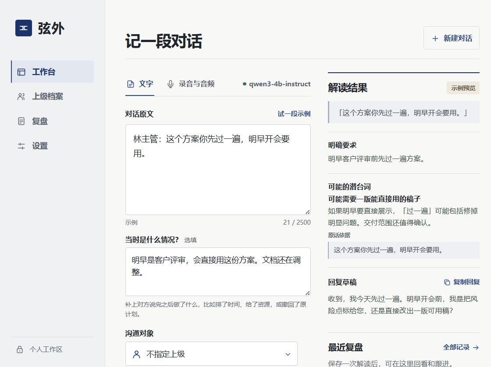
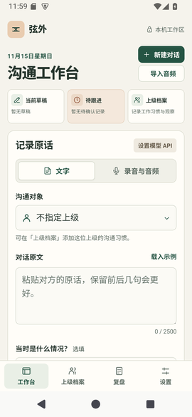
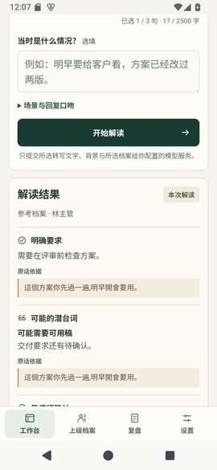
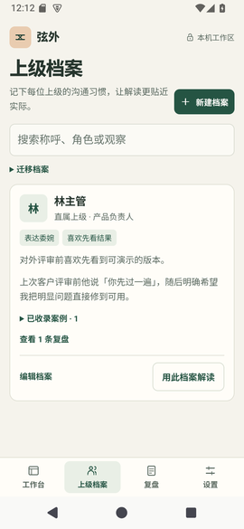

# 弦外 · 职场对话解读 (Xianwai)

[](https://github.com/sdss-arch/xianwai/actions/workflows/ci.yml)
[](https://github.com/sdss-arch/xianwai/releases)
[](LICENSE)

弦外是一款 **AI 职场对话解读应用**：贴入对话原文，或录音、导入音频并校对，再补充背景和选择一位上级，AI 会整理出明确要求、可能的潜台词、逐句原话依据和可复制的回复。可以为多位上级分别记录沟通习惯、优先事项和具体例子；模型也可以从你确认的案例中梳理沟通习惯，核对后加入档案。

**🌐 在线演示：** [点开即看，无需安装](https://sdss-arch.github.io/xianwai/)（预置示例解读）

**📥 下载：** [Windows 压缩包](https://github.com/sdss-arch/xianwai/releases/latest) · [Android APK](https://github.com/sdss-arch/xianwai/releases/latest) · 或按下方说明从源码运行。

## 界面截图

| 载入示例的工作台 | 真实模型解读结果（本机 Qwen3-4B） |
| --- | --- |
|  |  |

## 工作思路

```
对话输入（粘贴原文 / 录音 → 设备端离线转写 → 校对勾选）
   ＋ 背景补充 ＋ 上级档案（沟通习惯、优先事项、实例）
        ↓  模型解读（本机 llama.cpp 跑 Qwen，或任意 OpenAI 兼容接口）
明确要求 / 可能的潜台词 / 原话依据（逐句引用输入原字句）/ 可复制的回复
        ↓  保存复盘 → 填写实际结果 → 标记「已确认」或「解读有偏差」
模型提炼沟通习惯 → 人工核对后收录进上级档案
        ↓  下次解读只引用该上级最多三条相关案例，历史原话与本次证据分别呈现
```

- **导入与录音阶段不上传任何文字或音频**：勾选后的句子、背景和所选档案只在点「开始解读」时发送。
- 本机录音留在「复盘 → 本机录音」，可以重开、导出或删除；原音频和密钥不会包含在档案导出中。

## 快速开始（Windows 浏览器版）

> **方式 A —— 预编译包：** 从[最新发布](https://github.com/sdss-arch/xianwai/releases/latest)下载 `xianwai-windows-0.6.1.zip`，解压后直接看第 2 步，无需 git 或构建工具。
>
> **方式 B —— 从源码运行：**

1. 安装 [Node.js 22 或更新版本](https://nodejs.org/)，解压或克隆本项目。
2. 双击 `Start.cmd`。首次运行需要下载约 2.5 GB 的本地模型及推理程序，启动完成后会打开浏览器。
3. 点击「载入示例」填入一段对话，再点击「开始解读」。保持电脑和启动窗口运行。

旧版本占用默认的 8787 端口时，启动器会尝试 8793 和 8794。不同地址使用各自的浏览器存储，自建上级档案可通过「迁移档案」复制。

## 手机录音与转写（HTTPS 入口）

1. 手机和电脑连上同一个可信 Wi-Fi。在电脑的命令提示符中进入项目目录，运行 `Start.cmd -Phone -Address 电脑的局域网IPv4`。生成测试证书需要 Git for Windows 随附的 OpenSSL，也可用 `OPENSSL` 指定已安装的 OpenSSL。
2. 把窗口显示的 `root.cer` 传到手机，并确认名称为 `Xianwai Local Phone Preview` 加电脑 IP。iPhone 安装后，到「设置 → 通用 → 关于本机 → 证书信任设置」启用这张证书的完全信任。Android 使用系统的 CA 证书安装入口。该测试证书有效期为 30 天，试用结束后可从手机移除。已有受信任 HTTPS 部署时，可直接使用部署地址。[Apple 证书信任说明](https://support.apple.com/zh-cn/102390)
3. 打开启动窗口显示的 HTTPS 地址，选「录音与音频」。首次点击「转成文字」会加载约 100 MB 的模型和运行文件。录音和导入单段最长 2 分钟、最大 40 MB。可回听、编辑、勾选后再解读。

普通 HTTP 局域网入口可用于导入和文字分析。HTTPS 入口与 HTTP 入口的档案各自保存在浏览器。需要复用之前的上级档案时，在「上级档案 → 迁移档案」先导出，再到另一个入口导入。

## 安卓版

> **下载：** 从[最新发布](https://github.com/sdss-arch/xianwai/releases/latest)下载 `xianwai-android-0.6.1.apk`，或按下方「重新打包 Android APK」自行构建。

| 沟通工作台 | 解读与原话依据 | 上级档案 |
| --- | --- | --- |
|  |  |  |

1. 在 Android 手机上打开签名的 APK，按系统提示安装。首次从浏览器或文件管理器安装时，Android 可能要求允许该来源安装应用。
2. 打开「设置」，填入你的 HTTPS API 地址、模型名和服务商要求的密钥。支持 OpenAI 兼容的 Chat Completions 接口。可以先「测试连接」，再「保存设置」。密钥由 Android Keystore 配合加密保存在本机。
3. 在「解读」里录音或导入文件。安装包包含转写模型，录音、转写和校对都可离线使用。点「开始解读」时，手机通过自己的网络连接你配置的服务，只发送勾选后的文字、背景和所选档案。应用内录音留在「复盘 → 本机录音」，可以重开、导出或删除。
4. 可以选择职场场景和回复口吻，并把结果保存到「复盘」。回看时标记「已确认」或「解读有偏差」，写下后来实际发生的情况，再手动加入对应上级的档案。

Android 版最低支持 Android 8，转写依赖较新的 Android System WebView。原来在浏览器创建的档案，可以在浏览器「上级档案 → 迁移档案」导出，再在 App 导入。录音及校对单段最长 2 分钟，原音频和密钥都不会包含在档案导出中。

Android 0.6.1 与浏览器版共用语境判断和行动规则。可在「设置 → 个人信息」编辑职位、项目角色、职责权限及沟通偏好，也可在浏览器导出个人信息文件，再在安卓版导入、核对并保存。解读时勾选「解读时参考我的信息」才会把这些字段发给本次所用模型。

## iPhone 版

iPhone 版在 `ios/` 有独立的 Xcode 工程。工程包包含转写模型，使用 iOS 麦克风权限和钥匙串，原始录音保存在应用内。构建需要在 Mac 上选择 Apple 签名团队，请见 [`ios/README.md`](ios/README.md)。目前 iOS 版待构建、签名与真机验收。

只有 Windows 时，可用仓库的 **Actions → Build iPhone app → Run workflow** 在云端 Mac 检查真机平台能否编译（工作流会先打包界面和离线转写模型）。

## 工作台与复盘

- 对话原文、背景和已勾选的转写文字可以在工作台续写。重新打开时，保留的转写选句可以按文字继续编辑。原音频由设备上的录音库单独管理。
- 生成的回复可以先编辑，再复制或保存到复盘。修改后可更新同一条复盘。
- 复盘能按上级、状态和关键词筛选，也可添加标题、标签、跟进日期和置顶。跟进日期在工作台显示，打开 App 时可以看到到期数量。
- 「确认清单」用来填写已核实的交付物、截止时间、优先级和负责人。上级档案可以搜索，也能打开该上级的历史复盘。
- 浏览器版和 Android 版各自在本机保存草稿和复盘。Android 0.6.1 可覆盖安装此前的同签名版本，继续读取原有设备数据。

## 从复盘提炼上级沟通习惯

复盘需要关联一个上级。填写「确认清单」或把复盘标为「已确认」或「解读有偏差」并写下实际结果，保存后会出现「档案更新建议」。建议展示原话和你确认的要求，可以修改、略过或收录。弦外会尝试用当前模型提炼，模型暂不可用时仍可编辑并收录初稿。解读新对话时只选取该上级最多三条相关的已收录案例，历史原话与本次证据分别呈现。

## 浏览器 API 和录音

工作台的解读会给出立场判断、项目当前能否推进、改变判断的事实和下一步。证据不足时，可以直接在结果里补一句背景并重新解读。保存到复盘后，可回看当时的判断，等实际结果明确后再确认是否加入上级档案。

口头机会伴随增加工作时，解读会检查新旧任务是否已经排过先后。交办场景会参考当前对话和经本次授权提交的个人职责，沿用已明确的拍板边界，指出真正影响推进的缺口。

「设置 → 个人信息」可以填写职位、当前项目角色、职责权限、性格与表达偏好。信息保存在当前浏览器。工作台勾选「解读时参考我的信息」后才会在解读请求中发送，刷新后需重新勾选。

在 HTTPS 页面或电脑本机入口的「设置」中可填写并测试自定义 OpenAI 兼容 API，也可切回默认模型。浏览器密钥加密保存在当前浏览器，弦外服务只在调用时转发给所选 HTTPS 地址。

工作台可以直接录音和导入。录音保存在设备上的本机录音库，浏览器的录音存储在当前浏览器中。导入文件会自动开始离线转写，先校对、勾选，再开始解读。普通局域网 HTTP 页面可导入音频，浏览器要访问麦克风或配置自定义 API 时需要 HTTPS 或电脑本机入口。

## 数据与模型

- 默认通过电脑上的 llama.cpp 运行千问 Qwen3-4B-Instruct-2507，无需 API 密钥。两行对话的解读也可能需要数秒到几十秒。
- 音频由设备上的 Whisper 转写，导入文件和未勾选的转写句子留在设备上。直接录制的音频保存在「复盘 → 本机录音」，可从那里导出。
- 档案保存在当前浏览器。开始解读时提交所选文字、选填背景和当前所选档案。分析服务只处理本次请求。
- 结果是根据材料生成的推断。试用真实案例时，尤其留意是否把之前的经历当成了本次要求。
- 如需改用支持 OpenAI Chat Completions 结构化输出的模型，可直接 `node server.mjs`，在服务端设置 `MODEL_BASE_URL`、`MODEL_API_KEY`、`MODEL_NAME`。默认服务监听 `127.0.0.1:8787`。云端模式会在页面说明发送范围。

## 源码结构

```
xianwai/
├── public/            网页与手机端界面、录音、校对、档案管理（三端共用一份代码）
│   ├── app.js             应用主逻辑
│   ├── workspace.js       工作台
│   ├── audio.js           录音与导入
│   ├── asr-worker.js      离线转写（Transformers.js + ONNX Runtime Web 跑 Whisper）
│   ├── analysis-core.mjs    解读输入校验、提示词与依据组装
│   ├── workplace-analysis.mjs / workplace-actions.mjs   语境判断与行动规则
│   └── casebook.mjs       上级档案与案例
├── server.mjs         分析接口与静态服务，校验回传的句子编号，并用输入里的原句组装依据
├── Start.cmd/Start.ps1  Windows 启动器：下载 llama.cpp 与量化权重并启动
├── phone-https.mjs    手机预览用的本地 HTTPS 测试证书生成
├── android/           Android 原生壳（Java）与打包脚本 build.ps1
├── ios/               iPhone Xcode 工程与构建脚本
├── licenses/          第三方运行时组件授权说明
└── tests/             浏览器与安卓端自动化测试，见 tests/README.md
```

- 首次下载使用 [llama.cpp](https://github.com/ggml-org/llama.cpp/releases/tag/b12413) 和 [Qwen3-4B-Instruct-2507 量化权重](https://huggingface.co/bartowski/Qwen_Qwen3-4B-Instruct-2507-GGUF)。
- 转写使用 [Transformers.js](https://github.com/huggingface/transformers.js)、[ONNX Runtime Web](https://github.com/microsoft/onnxruntime) 和 [Whisper base 多语言 ONNX 权重](https://huggingface.co/Xenova/whisper-base)。运行文件授权见 `licenses/`。

### 重新打包 Android APK

Windows 上需要 JDK 17 或以上、Android SDK Platform 35、Android Build Tools 35、Node.js 22 或更新版本、Python 3 和签名密钥。设置 `XIANWAI_SIGNING_PASSWORD` 后运行 `android/build.ps1`，传入 Java、Build Tools、android.jar、签名文件和构建路径。转写权重未缓存时会从固定版本下载。保留同一签名能够覆盖安装后续版本。

### 测试

浏览器端用 Playwright，安卓端用 adb + uiautomator，测试音频与导入样例在 `tests/fixtures/`。环境变量、端口与各脚本说明见 [`tests/README.md`](tests/README.md)。

```bash
npm install
PORT=8787 node server.mjs        # 另开窗口
node tests/browser/check.mjs
```

## 参与贡献

欢迎任何形式的参与：修复 Bug、补充测试、完善文档、提功能建议，或在[讨论区](https://github.com/sdss-arch/xianwai/discussions)分享使用心得。项目刚开始开源，最需要的帮助是：

- **试用并反馈**：用真实对话跑一跑，把不对劲的地方提成 [Issue](https://github.com/sdss-arch/xianwai/issues/new/choose)
- **认领任务**：从标注 [good first issue](https://github.com/sdss-arch/xianwai/labels/good%20first%20issue) 的小任务开始
- **完善文档**：使用教程、场景示例、常见问题，都欢迎直接提 PR

贡献流程与代码规范见[参与指南](CONTRIBUTING.md)；参与前请阅读[行为准则](CODE_OF_CONDUCT.md)。所有贡献者提交即表示同意以 [MIT 许可证](LICENSE)授权其贡献。

## 免责声明

弦外给出的是根据所提交材料生成的推断，不是对他人意图的确定判断，也不构成职业或法律建议。试用真实案例时，尤其留意是否把之前的经历当成了本次要求。

## 许可证

[MIT](LICENSE) © sdss-arch。第三方运行时组件的授权见 [`licenses/`](licenses/)。
